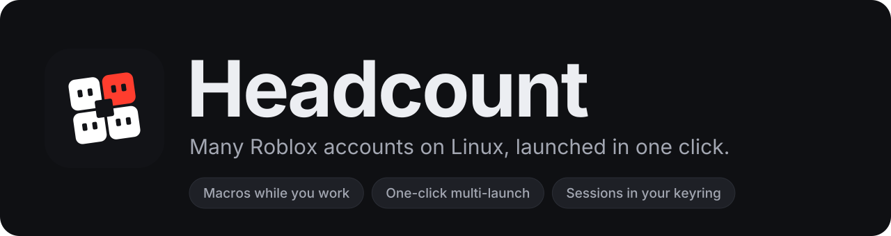

<p align="center">
  
</p>

<p align="center">
  <a href="https://github.com/DamnShabu/headcount/actions/workflows/ci.yml"></a>
  <a href="https://github.com/DamnShabu/headcount/releases/latest"></a>
  <a href="https://github.com/DamnShabu/headcount/releases"></a>
  <a href="https://scorecard.dev/viewer/?uri=github.com/DamnShabu/headcount"></a>
  <a href="LICENSE"></a>
</p>

<p align="center">
  <b>Your main and all your alts, signed in once and launched together.</b><br>
  Headcount is a Roblox account manager and multi-instance launcher for Linux.
  It runs a room full of Roblox clients, plays macros into them while you use
  your desktop, and tells you at a glance which one needs you.
</p>

<p align="center">
  <a href="#install"><b>Install</b></a> ·
  <a href="#quick-start"><b>Quick start</b></a> ·
  <a href="docs/guide.md"><b>Guide</b></a> ·
  <a href="docs/advanced-macros.md"><b>Python macros</b></a>
</p>

> [!WARNING]
> Roblox's terms don't allow running more than one client at once, and people
> have reported anti-cheat flags for it. Installing the app does nothing on its
> own. The risk starts when you launch a second client, and that only happens
> when you click Launch. Use alts you can afford to lose.

## Why Headcount

<table>
<tr>
<td width="50%" valign="top">

**🎯 Macros while you work**<br>
Key-and-click macros play into a client's own display, so they keep going
while you use your desktop, and with the window hidden. Record them by
playing, or have them react when something shows on screen.

</td>
<td width="50%" valign="top">

**🚀 One click, many accounts**<br>
Tick accounts and launch them together, into a game or into a friend's
server. Groups give each set of alts a game of its own.

</td>
</tr>
<tr>
<td valign="top">

**🧊 A dozen clients without melting the machine**<br>
Each account has a performance level, from 10 FPS on the lowest graphics to
the game's top graphics, and the window shows each client's CPU and memory.

</td>
<td valign="top">

**🔑 No passwords**<br>
Accounts sign in with Roblox Quick Login, and sessions live only in your
desktop's keyring.

</td>
</tr>
<tr>
<td valign="top">

**🩹 Signed out? Fixed in place**<br>
Accounts Roblox signed out show up under **Needs attention**, with
**Sign in again** beside them.

</td>
<td valign="top">

**🌐 The Play button on roblox.com**<br>
Opens a small popup where you pick which accounts join.

</td>
</tr>
<tr>
<td valign="top">

**🐍 Python when steps aren't enough**<br>
Advanced macros are Python scripts, written against the `rbxmgr` module.
[Advanced macros](docs/advanced-macros.md)

</td>
<td valign="top">

**🔄 Updates itself**<br>
**Update** gets the newest Headcount and Roblox runtime; **Update All** gets
the newest Roblox build too.

</td>
</tr>
</table>

Roblox itself runs in [Stacked](https://github.com/DamnShabu/stacked), a fork
of Cordial, the runtime for Roblox's official Android build. Headcount installs
it and keeps it up to date ([how](cordial/README.md)).

## Install

Download a package from the
[latest release](https://github.com/DamnShabu/headcount/releases/latest)
(x86_64 only):

| Distro | File | Install |
| --- | --- | --- |
| Debian, Ubuntu, Mint, Pop!_OS | `headcount_*_amd64.deb` | `sudo apt install ./headcount_*_amd64.deb` |
| Fedora, openSUSE | `headcount-*.x86_64.rpm` | `sudo dnf install ./headcount-*.x86_64.rpm` |
| Arch, Manjaro | `headcount-*-x86_64.pkg.tar.zst` | `sudo pacman -U headcount-*.pkg.tar.zst` |
| Any distro (Flatpak) | `headcount-*-x86_64.flatpak` | `flatpak install --user headcount-*.flatpak` |
| Any distro (single file) | `headcount-*-x86_64.AppImage` | `chmod +x` it and run it |

**NixOS:** add this repo as a flake input and import
`inputs.headcount.nixosModules.default`, or try it without installing:

```sh
nix run github:DamnShabu/headcount
```

You'll also need:

- **A keyring** (GNOME Keyring, or KWallet with Secret Service support).
  Sessions are stored there and nowhere else.
- **A Wayland session** if you want to use macros.

The first launch downloads the Roblox build. That takes a few minutes, and
progress shows under **Activity**.

> [!NOTE]
> **Headcount was called Roblox Manager** up to 0.13. An existing install
> updates to Headcount on its own, and keeps its accounts, sessions, groups
> and macros. The `roblox-manager` command still works.

## Quick start

1. **Add an account.** Click **+** (<kbd>Ctrl</kbd>+<kbd>N</kbd>), open
   Quick Login on any device where you're signed in, and enter the code.
   Repeat for each account. [Adding accounts](docs/guide.md#add-an-account)
2. **Pick where to go.** The target picker next to **Launch** lists your
   favourite games, Roblox's games browser and your friends' servers.
   [Launch targets](docs/guide.md#launch-into-a-game)
3. **Launch.** Tick the accounts and click **Launch**
   (<kbd>Ctrl</kbd>+<kbd>Shift</kbd>+<kbd>Enter</kbd>).
4. **Leave them a macro.** Make one under **Macros** in the sidebar, pick it
   in an account's settings, launch again and press **Run**.
   [Setting up macros](docs/guide.md#macros)

Macros can also be bound to a desktop hotkey:

```sh
gapplication action io.github.mujo.RobloxManager run-macro "'Anti-AFK'"
```

## FAQ

**Can I run more than one Roblox client at once on Linux?** Yes, that is what
Headcount is for. Tick the accounts and click **Launch**. Read the warning at
the top first.

**Do I need Sober, Wine or Waydroid?** No. Headcount downloads and updates its
own runtime, [Stacked](https://github.com/DamnShabu/stacked), which runs
Roblox's official Android build natively.

**Can it keep my alts from going AFK?** Yes. A new macro starts out as an
anti-AFK one, pressing space every one to four minutes, and it plays into
every client you pick with their windows hidden.

**Which distros?** Any x86_64 distro: there are `.deb`, `.rpm`, Arch,
Flatpak, AppImage and Nix packages. ARM isn't supported.

## Documentation

- **[The guide](docs/guide.md)**: accounts, the window, launching, groups,
  links from the website, account settings, macros, updates, shortcuts and
  troubleshooting.
- **[When steps](docs/macros-when.md)**: macros that react to what's on
  screen.
- **[Advanced macros](docs/advanced-macros.md)**: macros written in Python,
  through the `rbxmgr` module.
- **[Development](docs/development.md)**: how the code fits together,
  building, checks and releases.
- **[Cordial](cordial/README.md)**: the runtime the clients run in, and how
  Headcount keeps it updated.

## Privacy and security

Headcount never sees your password, and sessions are kept only in your
keyring. When Headcount updates itself, the download is checked against the
release's `SHA256SUMS`, and each release asset carries a build-provenance
attestation you can check:

```sh
gh attestation verify headcount-*-x86_64.AppImage -R DamnShabu/headcount
```

See [SECURITY.md](SECURITY.md) to report a problem.

| What | Where |
| --- | --- |
| Accounts, groups, macros | `~/.local/share/rbxmgr` |
| Sessions | Your keyring only |
| Cordial profiles and config | `~/.local/share/cordial`, `~/.config/cordial` |
| Window size and style | `~/.local/state/rbxmgr` |
| Game icons, avatars, client logs (safe to delete) | `~/.cache/rbxmgr`, `~/.cache/cordial` |

## Contributing

Bug reports and pull requests are welcome. [CONTRIBUTING.md](CONTRIBUTING.md)
says how, and `nix run .` builds and runs Headcount from a checkout. If
Headcount saves you time, a ⭐ helps other Linux players find it.

## Licence

[MIT](LICENSE). Headcount is not affiliated with, endorsed by or sponsored by
Roblox Corporation. "Roblox" is a trademark of Roblox Corporation.
